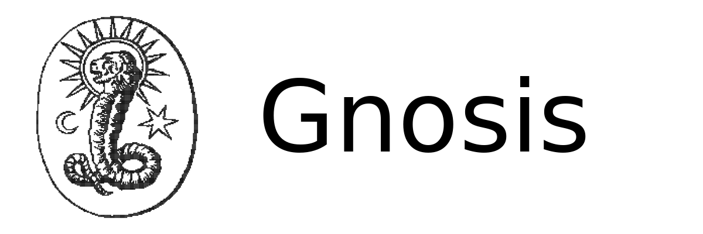
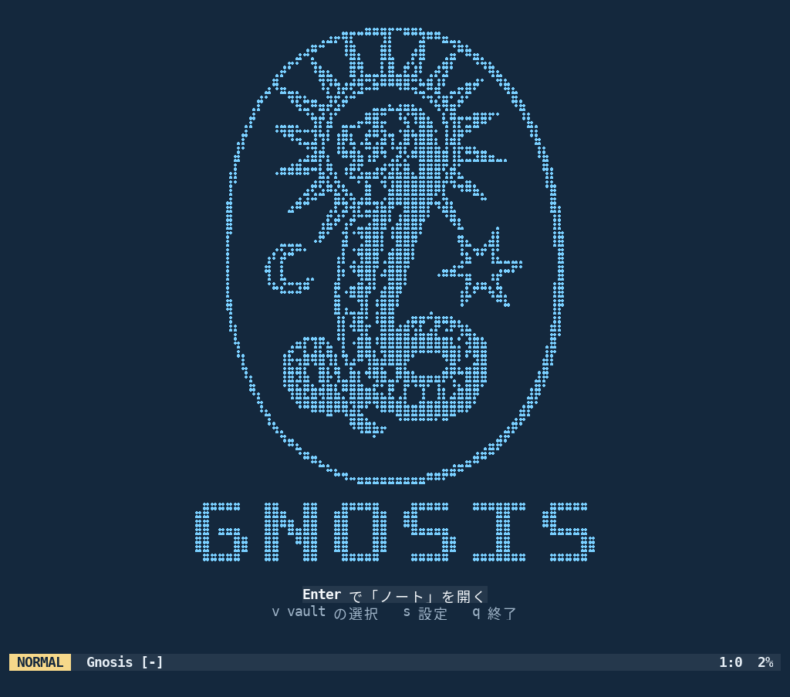

<p align="center"></p>

# Gnosis

**Gnosis** は、Markdown のノートを本物の Vim で書き、リンクでつないで育てる PKM（Personal Knowledge Management）です。
旧名は **simple-yurii-note**（2026-10 に改名）。ノートの形式と操作は、そのまま引き継いでいます。

*Gnosis is a PKM for Markdown notes written in real Vim. Notes are linked into Context / Group / BackLink automatically.
The UI and the generated guide are available in Japanese and English (see [English summary](#english-summary)).*

<p align="center"><br><sub>起動画面（ターミナルの Vim。<code>tools/make_start_screenshot.py</code> で作り直せます）</sub></p>

- 1 ファイル = 1 ノート（Markdown）。関係はリンクで表し、冒頭の `Context:` と `### Group` / `Related:` / `BackLink:` などを保存時に自動で同期
- 中身は本物の Vim。Vim を知らなくても、インストーラーが Gnosis 専用の Vim 環境を作り、アイコンから起動できる
- 標準の画面は Bash などのターミナルで起動する本物の Vim。独自 GUI ではない（Electron は明示的な `--app` のときだけ使用できるオプション）
- 起動画面で vault（ノートのフォルダ）を選び・作り・登録できる。設定は vault ごと（言語・見た目・起動サイズ・テーマ）。文字サイズは Gnosis 全体で 1 つ
- 日本語 / 英語。操作ガイドも選んだ言語で作られる

リポジトリ: https://github.com/Yurii7812/gnosis

---

## インストール

**コマンドを 1 回コピーして、1 回貼り付けるだけです。** あとは自動で、必要なもの（**git が無ければ git も**、Vim・Python など）の確認と導入、取得、設定、アイコンづくりまで行います（導入の前に確認を聞きます。Mac で git が無いときは、Apple のコマンドライン・ツールの導入画面が開くので、終わったらもう一度同じ 1 行を実行）。

| OS | 貼り付けるもの |
| --- | --- |
| **Linux・macOS** | `curl -fsSL https://raw.githubusercontent.com/Yurii7812/gnosis/main/install/bootstrap.sh \| sh` |
| **新しい Debian / Ubuntu（git も curl も無い。スマホの UserLAnd など）** | `sudo apt update && sudo apt install -y curl && curl -fsSL https://raw.githubusercontent.com/Yurii7812/gnosis/main/install/bootstrap.sh \| sh` |
| **Windows 10 / 11**（PowerShell） | `irm https://raw.githubusercontent.com/Yurii7812/gnosis/main/install/bootstrap.ps1 \| iex` |

- 入れたあとの更新は `gnosis --update`（Windows はアイコンから開いた Gnosis の中でも、同じ 1 行をもう一度実行してもよい）。
- 画面（GUI）の無い環境（スマホの Debian・SSH）では、`gnosis` は今の端末の中で起動します。
- コマンドは**1 行ずつ**貼り付けてください（2 つをつなげて貼ると `./install/install.shgit clone …` のようになって動きません）。
- 以下は、手順を自分で確かめたい人・開発者向けの詳しい説明です。

ふだんの Vim の設定（`~/.vimrc`・`~/.vim`・`_vimrc`・`vimfiles`）は**読み込まず、変更もしません**。
インストーラーは Gnosis 専用の vimrc とプラグイン領域を **Gnosis ホーム**に作り、その vimrc を指定して起動するランチャーとアイコンを作ります。
Vim が無ければ入れ、Gnosis に使える Vim（8.2 以上、`+job +channel +timers +textprop +popupwin`）が既にあればそれを使います。
ふつうに `vim` を起動すれば、今までどおりの Vim です。

### Linux

1 行で入れる（上の表。git が無くても入ります）:

```sh
curl -fsSL https://raw.githubusercontent.com/Yurii7812/gnosis/main/install/bootstrap.sh | sh
```

自分で取得して入れる（git が必要）:

```sh
git clone https://github.com/Yurii7812/gnosis.git
cd gnosis
./install/install.sh
```

**2回目以降の更新は、このコマンドだけで実行できます。**

```sh
gnosis --update
```

`gnosis --update` は GitHub の `origin/main` から最新版を確認し、Gnosis 本体・専用プラグイン・ランチャー・アプリメニューを更新します。確認の入力は不要で、システムパッケージのインストールは行いません。現在のブランチが `main` で、`origin/main` を追跡していることが必要です。

初めてこのコマンドを導入するときは、古い Gnosis にはまだ `--update` がないため、最初の1回だけ次を実行してください（PRのマージ後）。

```sh
cd ~/gnosis
git status --short
git switch main
git pull --ff-only origin main
./install/install.sh
```

`git status --short` で変更がある場合は、変更を残すため `git switch` / `git pull` の前に確認してください。以降は `gnosis --update` だけで更新できます。

- 未コミットの変更があるフォルダは更新しません（変更は消しません）。`--no-update` で取り込みを止められます
- 別のフォルダに新しく clone して入れると、ランチャーとアプリメニューはそのフォルダを指すように作り直されます（前のフォルダは消しません）
- 開いている端末は古い場所を覚えていることがあります。`hash -r` を実行するか、端末を開き直してください
- 最後に、インストール先・Gnosis ホーム・vimrc・Vim・Python・コミット・最新かどうか・ランチャー・起動項目を表示します
- どの Gnosis が起動するかは `gnosis --where`、導入の問題は `gnosis --doctor` で確かめられます

必要なもの（足りなければ、確認してから apt / dnf / pacman / zypper / Homebrew で入れます。`--no-system` で入れない）:

| 種類 | もの | 無いとき |
| --- | --- | --- |
| 必須 | Vim 8.2 以上（`+job +channel +timers +textprop +popupwin`）・git・Python 3 | インストールは失敗で終わります |
| 推奨 | fzf（無ければ Gnosis 専用に取得）・ripgrep | 検索が使えない・遅い |
| 推奨 | python3-venv と pykakasi（Gnosis ホームの `venv` に入れる。Debian の externally-managed な Python でも可） | よみ順の並べ替えが文字コード順 |
| 推奨 | クリップボード: Wayland は wl-clipboard、X11 は `+clipboard` の Vim（Debian は `vim-gtk3`）か xclip | PC のクリップボードとの受け渡しができない |
| 機能別 | 暗号化 vault: gocryptfs・FUSE（`--with-crypt`。暗号化 vault が登録済みなら自動で確かめる） | 暗号化 vault を開けない |
| 機能別 | 紙の日記の取り込み（`\F`）: tkinter・Pillow（`--with-scan`） | その画面が開かない |
| 機能別 | Electron アプリ: Node.js（`--app` のときだけ） | — |

- アプリメニューの **Gnosis** でも、Bash などの端末から `gnosis`（`~/.local/bin/gnosis`）を実行しても、Gnosis専用の新しい端末ウィンドウを開いて Vim を起動します。今の端末内で開く場合だけ `gnosis --tui` を指定してください
- デスクトップにもアイコンを置くなら `--desktop-icon`（前に置いたものがあれば作り直します）

### macOS

```sh
git clone https://github.com/Yurii7812/gnosis.git
cd gnosis
./install/install.sh
```

Homebrew で足りないものを入れ、`~/Applications/Gnosis.app` を作ります（Finder・Launchpad から起動）。

### Windows 10 / 11

**PowerShell（Windows PowerShell 5.1 で可）に次の1行を貼り付けて実行します。** Git・Python・Vim・Ubuntu・WezTermを事前に用意する必要はありません。

```powershell
irm https://raw.githubusercontent.com/Yurii7812/gnosis/main/install/bootstrap.ps1 | iex
```

動作: GitHubの最新コミットを1つに特定してHTTPSで取得し、コミットとの一致を確認してから実行します。WSL2・Ubuntu・WezTermが無ければ確認のうえ導入し、Ubuntu内（`~/gnosis`）にGnosis専用のVim・プラグイン・Python環境を作り、検証に成功してからデスクトップとスタートメニューに「Gnosis」を作成します。以後はアイコンのダブルクリックだけで、**WezTerm → WSL2 Ubuntu → `gnosis --tui`（通常のVim）**が開きます。

利用者の操作が必要な場面（自動化できません）:
- WSL2の有効化時のWindowsの管理者確認（UAC）と、必要な場合の**再起動**。再起動後は次回サインイン時に続きから自動再開します（1回のみ）。
- Ubuntu初回のユーザー名・パスワード設定（Ubuntu自身の画面で入力。インストーラーは保存しません）。
- Linuxパッケージ導入時にUbuntuのパスワード（sudo）を聞かれることがあります。

対応条件: Windows 11、またはWindows 10 バージョン2004（ビルド19041）以上／CPUの仮想化が有効／インターネット接続／WezTermの自動導入にはwinget（App Installer）が必要。Windows 10では未検証です。企業ポリシーでWSL・管理者権限・ダウンロードが禁止されている環境では完了できません（その場合は理由を表示して終了し、成功とは表示しません）。

バージョンを固定する場合は、実行前に `$env:GNOSIS_REF = 'タグ名またはブランチ名'` を設定します。ログは `%LOCALAPPDATA%\Gnosis\install.log` です。失敗しても、同じ1行をもう一度実行すれば済んだ手順は飛ばして続きから進みます。

開発者向け（リポジトリを既に持っている場合）:

```bat
powershell -ExecutionPolicy Bypass -File install\install.ps1
```

Windowsの標準構成は、**Gnosisのターミナル版（Vim）**です。Windows版Electron GUIへの置換は行いません。WSL2上のUbuntuとWezTermを使用し、GnosisのLinux用依存関係・Vim・プラグインをインストールします。必要なファイルが揃ったことを確認してから、Windowsの**デスクトップとスタートメニューに「Gnosis」起動アイコン**を作成します。アイコンからGnosis専用のターミナルが開き、その中でVimを直接実行します。

Electron GUIは標準ではインストールされません。別途明示的に試したい場合のみ、`powershell -ExecutionPolicy Bypass -File install\install.ps1 -NativeApp` を使用します。WSL2や既存ノートを削除せず、通常のVim設定も変更しません。

### アンインストール

`install/uninstall.sh`（Linux / macOS）はランチャー・アプリメニュー・アイコンを取り除きます。vault（ノート）は消しません。
`--purge` を付けると Gnosis ホーム（vault の一覧・テーマ・プラグイン）も消します。

---

## 起動

| 方法 | 動き |
| --- | --- |
| アイコン（Linux アプリメニュー / macOS Gnosis.app） | ターミナルを開いて Vim で起動（Windows は別ランチャー） |
| `gnosis` | **必ず Gnosis 専用の新しい端末ウィンドウ**で起動。保存した文字サイズ・フォント・行間を適用。現在の端末には影響しない |
| `gnosis --app` / `--gui` / `--tui` | 明示的な場合のみ Electron / GUI Vim / 今の端末の Vim |
| `gnosis --tui` / `--terminal` | いま開いている端末内の Vim で起動。フォントサイズは現在の端末の設定を使用 |
| `gnosis --new-terminal` | `gnosis` と同じく専用の新しい端末で起動（従来との互換性） |
| `gnosis ノート.md` | そのノートを開く（起動画面は出さない） |
| `gnosis --where` | Gnosis のフォルダ・コミット・Gnosis ホーム・使う vimrc・Vim を表示 |
| `gnosis --doctor` | 導入の診断（古い版・PATH の古いランチャー・古いアプリメニュー項目・必要なもの・文字サイズ） |
| `gnosis --update` | GitHub の `origin/main` を確認し、最新版を安全に取得して Gnosis 専用環境・ランチャーを更新 |

### 起動画面

ノートを開く前に、**ダークの背景 `#1E1E1E` に、ダークのリンクの色 `#6CB6FF` で描いた Chnoubis** の起動画面が出ます。Chnoubis は `chnoubis3.sh` の元の Unicode Braille 図案で、下の **GNOSIS ロゴも文字列ではなく点描グラフィック**です。端末の大きさに合わせて図案とロゴの大きさを選び、窓の大きさや文字サイズが変わると描き直します（狭いときは余白・補足の行・ロゴの順に省き、図案と「Enter で開く」を残します）。文字のマスが横長で元の図案が横に伸びて見える端末では横幅を詰めた図案を、行の高いフォント（日本語用の等幅フォントなど）でマスが縦長のときは点の単位で縦に縮めた図案を使うので、どのフォントでも崩れません（`let g:gnosis_start_art = 'original'` / `'fit'` で固定）。案内には「Enter で「前回の vault 名」を開く」と出ます。

| キー | 動き |
| --- | --- |
| `Enter` | 選択中の vault を開く（前回の vault が選ばれている） |
| `v` | vault の選択・管理 |
| `s` | 設定 |
| `q` | 終了 |

vault の一覧: `j` / `k` で選ぶ・`Enter` で開く・`a` 既存のフォルダを登録・`n` 新しい vault を作る・`d` 一覧から外す（**ノートとフォルダは消しません**）・`Esc` 戻る。
初めての起動（vault が無い）でも Chnoubis の起動画面を表示し、`Enter` / `v` から vault を作るか登録するか選びます。前回の vault が見つからないときは、元の場所に勝手に作らず、選び直し・場所の指定し直しを案内します。
使用中に vault を切り替えるときは `:GnosisVaults`（保存先・検索・同期・設定がその vault に切り替わります）。

### 見た目（読みやすさ）

見た目は **ダーク（既定）** と **ライト** の 2 つです（設定画面の「テーマ（ダーク／ライト）」）。2026-10-21 から、背景・文字・見出しを **Obsidian に合わせて**います（リンクの色は今までどおり。アクセントは Obsidian の紫ではなく、ライトは黒・ダークは明るい灰色）（`assets/themes/builtin.json`・`colors/gnosis.vim`・`web/styles.css`）。

| 要素 | ダーク（背景 `#1E1E1E`） | ライト（背景 `#FFFFFF`） |
| --- | --- | --- |
| 本文 | `#DADADA` | `#222222` |
| リンクの表示名 | `#6CB6FF` ＋下線 | `#0969DA` ＋下線 |
| 見出し | 本文と同じ色の太字（大きさは Obsidian と同じ 1.618 / 1.462 / 1.318 / 1.188em） | 本文と同じ色の太字 |
| 補助の文字（行番号・パス・front matter の項目名） | `#B3B3B3` | `#5C5C5C` |
| 選択 | `#474747` | `#D6D6D6` |

起動画面（Vim の起動画面・`\A` の起動画面とも）はダークの背景 `#1E1E1E` に、Chnoubis と GNOSIS ロゴをダークのリンクの色 `#6CB6FF` で描きます。以前の青系の配色（夜空色 `#0C1D32` の Chnoubis 10番と、青系の標準）は `assets/themes/archive/gnosis-blue.json` に保管しています（以前「標準」を選んでいた vault はダークになります）。
斜体は Markdown の `*強調*` だけに使い、コメントなどには使いません。リンクの手前の番号（`1`〜`9`・`0`・`g1` …）は控えめな色の札で出ます。

- Markdown のリンクは、ふだんは**表示名だけ**が見えます（`[表示名](ファイル名)` の括弧とファイル名は隠れる）。元の Markdown を直したいときは `:GnosisLinkSource` で見せる／隠すを切り替えます（そのバッファだけ）
- 配色を変えるには、設定画面の「カスタム配色を作る・直す」か、追加テーマ。カスタム配色の編集画面では、6 つの色（背景・本文・リンク・見出し・選択範囲・カーソル行）を HEX コード・色見本・カラーパレット（8 色相 × 9 段階）で選べ、**日本語のサンプル文（見出し・リンクの表示名と下線・選択範囲・カーソル行）にすぐ反映**されます（保存するまで設定もノートも変わりません。Esc で取り消し）
- **`\A` のアプリ（Electron）も、既定は通常の Vim と同じ見た目（ダーク／ライト）**です。設定画面でアプリ用の配色を別に作ることもできます（アプリの設定画面では、カラーピッカーも使えます）
- 端末が 24bit 色に対応していれば（`COLORTERM=truecolor`）その色、そうでなければ近い 256 色で表示します
- **フォントの種類・太さ・アンチエイリアス・行間・透過は端末が描く**ので、Vim の配色では変えられません。Gnosis が開く Konsole の窓では、Gnosis 専用プロファイルで、等幅フォント（既定は Hack など入っているもの。日本語は端末のフォント置き換えで、Noto Sans CJK JP が入っていればブラウザと同じ字形。設定画面の「フォント」で、入っているフォントの一覧から選べます）・行間 2px・アンチエイリアス・Gnosis の配色を使います

### 文字サイズ

文字サイズは vault ごとではなく **Gnosis 全体で 1 つ**です（Gnosis ホームの `terminal.json`。暗号化 vault を開く前のランチャーも読めます）。設定画面の「文字サイズ」の行で `+` 大きく・`-` 小さく・`0` 標準（16）・`Enter` 数字で指定、または `:GnosisFontSize 20`（`+1` / `-1` / `reset`）。フォント名・行間・**Gnosis の窓に使う端末**も設定画面で選べます（自動ならデスクトップに合う端末: KDE は Konsole、XFCE は XFCE Terminal、GNOME は GNOME Terminal）。

文字を描いているのは Bash でも Vim でもなく**端末エミュレーター**なので、できることは端末ごとに違います。

| 端末 | Gnosis の窓を開くとき（`gnosis`・アイコン・`gnosis --new-terminal`） | その場で変える（設定画面の `+` / `-`） | 確認 |
| --- | --- | --- | --- |
| Konsole | Gnosis 専用プロファイルの絶対パスと `-p Font` によって起動時サイズを明示（専用 state に分離） | Gnosis が開いた窓でだけ、D-Bus でプロファイルを切り替えて変える（切り替わったことを Konsole に聞いて確かめる）。ふだんの Konsole の窓では変えない | Konsole 25.04 で確認 |
| XFCE Terminal | `--font "フォント 大きさ"` | できない（保存して、次の窓から） | 起動時の指定を確認 |
| xterm | `-fa フォント -fs 大きさ` | できない | 起動時の指定を確認 |
| kitty | `-o font_size`。Gnosis の窓は遠隔操作を許可 | `kitty @ set-font-size`（ふだんの窓で変えたら終了時に戻す） | 未確認（未導入） |
| Alacritty | `-o font.size` | `alacritty msg config`（0.13 以降） | 未確認（未導入） |
| WezTerm | `--config font_size` | できない | 未確認（未導入） |
| GNOME Terminal | Gnosis専用プロファイルを作って保存済みのフォントサイズを適用（通常のGNOME設定は変更しない） | GSettingsで専用プロファイルのフォントを更新（利用可能な環境のみ） | 実機未確認 |
| foot | Gnosis用の `--font "名前:size=N"` で起動 | 次の窓で適用 | 実機未確認 |
| Ghostty | Gnosis用の `--font-size=N` で起動 | 次の窓で適用 | 実機未確認 |
| GUI 版 Vim | `guifont` | `guifont` | — |

- その場で変わらない端末でも、値は保存され、**次に Gnosis の窓（`gnosis`・アイコン・`gnosis --new-terminal`）を開いたときに使われます**。画面には「保存した」と「この窓に反映した」を分けて表示します
- 端末の `Ctrl` + `+` / `-` / `0` は**端末が処理して Vim には届かず**、変えた大きさを Vim から読み取る方法もないため、Gnosis には保存されません（その場だけ）
- 既にある Bash の窓で `gnosis` を実行しても、新しいGnosis専用ウィンドウを開きます。元のBashの文字サイズ・設定は変更しません。現在の端末で開きたいときだけ `gnosis --tui` を使います
- ふだんの端末の設定・プロファイル・ふだんの Vim は変更しません
- 端末のフォントは端末エミュレーター自身が描くため、あらゆる実装で同じ方法で即時変更できる共通APIはありません。Gnosisが対応する端末では開いた瞬間に適切なサイズを指定し、即時変更APIが無い端末では設定を保存して次回起動に適用します。対応できない環境でも「今変わった」と誤表示しません。

### 設定（`:GnosisSettings` / 起動画面の `s` / アプリの「設定」）

vimrc を書き換えずに、vault ごとに設定します（`<vault>/.gnosis/settings.json`）。文字サイズ・フォント・行間・使う端末は Gnosis 全体の設定です（上の「文字サイズ」）。

- 言語（日本語 / English）… メッセージ・メニュー・入力案内・操作ガイド
- 起動時に最大化（既定: する。全画面表示ではありません）・通常のウィンドウサイズ
- ライト / ダーク
- テーマ … 標準・カスタム配色（背景・本文・リンク・見出し・選択範囲・カーソル行）・追加テーマ（通常の Vim 用）
- アプリ（`\A`）の配色 … 標準（白）・自分で作ったカスタム配色（通常の Vim の配色とは別。`appTheme` / `appCustomThemes`）
- テーマの追加 … `Plug 'cocopon/iceberg.vim'` のように入力。Vim script としては実行せず、`作者/リポジトリ` だけを取り出して Gnosis ホームの `themes/` に取得します。読み込めないテーマは標準に戻ります

---

## 主な操作

詳しくは vault の中の操作ガイド（`gnosis-guide.md`。旧 vault では `simple-yurii-note-guide.md`）と [docs/04-キー操作.md](docs/04-キー操作.md)。

| キー | 動作 |
| --- | --- |
| `zn` | ノート作成（`h` カーソル直下 / `Enter` 本文の最後 / `t` 見出しの下 / `c` Context 末尾 / **`b` ChildBranch（直接の子）/ `p` ParentBranch（直接の親）** / `o` 孤立） |
| `zk` | グループ作成（位置キーは `zn` と同じ） |
| `zk`（ビジュアル） | 選択範囲を中身にしたグループ |
| `za` / `zA` / `zp` | クリップボード・ヤンクのリンクを追加（`zA` は表示名つき） |
| `\l` | 全文検索 → リンクを追加（**`n` = 表示名を入力して本文の最後へ** / **`g` = 選んだグループに今のノートを入れる（表示名も聞く）**） |
| `\L` | ファイル名のリンク化 / 選択範囲から新ノート |
| `\S` | リンク行をよみ順に並べる（**グループでは本文の最後のブロックだけ**） |
| `\d` | 今日の日記 |
| `zw` | 今のノートの本文の一番下（空行を 1 つ空けた所）から書き始める |

**`b` / `p`（Branch。`zn` / `zk` / `za` / `\l`）**: Folgezettel のような「直接のブランチ」を**明示**します（識別子から親子は推測しません）。`b` は今のノート A が親・B が子、`p` は B が親・A が子（どちらも同じ処理）。親のノートの `ChildBranch:` と子のノートの `ParentBranch:` の両方に書きます。**親は 1 ノートに最大 1 つ**（子は何本でも）。B に既に親があれば、現在の親のタイトルを示して**拒否**し、どちらのノートも変更しません（親の付け替えはしません）。自分自身・循環・`index.md` も拒否。保存や同期のあとも維持され、`### Context` には変換されません。`:GnosisBranchCheck` で整合性（親が複数・片側だけ・循環）を検査できます。

**`c` のあと（`zn` / `zk` / `za` / `\l`）**: 今のノート A の Context にリンク先 B を入れたあと、B に A へのリンクをどう入れるかを選びます。

| キー | B 側 |
| --- | --- |
| `Enter` | B の本文の最後（関係の節の手前） |
| `t` | B の見出しを選び、その節の最後（次の同じか上の階層の見出しの手前） |
| `o` | 入れない（A 側の追加はそのまま。操作の取り消しではありません） |
| `Esc` | 取り消し（A にも B にも何も書きません） |

B がグループなら、表示名を入力します。入力欄は空から始まり、空のまま `Enter` で A のタイトル、文字を入れて `Enter` でその文字、`Esc` で取り消し。
表示名はノートのタイトルやファイル名を変えず、保存・同期しても残ります（自動生成の BackLink とは別もの）。

アプリでは、リンクを `Alt` + クリックすると、開かずにカーソルだけがリンクに移ります。

---

## 置き場所

| もの | 場所 |
| --- | --- |
| Gnosis 本体 | `git clone` したフォルダ（更新はそのフォルダで `./install/install.sh`） |
| Gnosis ホーム（Gnosis 側の状態） | Linux `~/.local/share/gnosis`（`$XDG_DATA_HOME/gnosis`）・macOS `~/Library/Application Support/Gnosis`・Windows `%APPDATA%\Gnosis`。`$GNOSIS_HOME` で変更可 |
| ├ `vaults.json` | 登録済みの vault と最後に選んだ vault |
| ├ `vimrc` / `vimrc.local` | 専用の vimrc（インストーラーが作る）/ Gnosis だけの追加設定（任意） |
| ├ `plugins/` / `themes/` | 専用のプラグイン（fzf・fzf.vim・vim-surround）/ 追加したテーマ |
| ├ `terminal.json` | 文字サイズ・フォント・行間・Gnosis の窓に使う端末（Gnosis 全体） |
| ├ `terminal/share/konsole/` | Gnosis が開く Konsole の窓だけが読む専用プロファイル（ランチャーが毎回作る） |
| ├ `venv/` | Gnosis 専用の Python（pykakasi） |
| └ `logs/` / `state/` | ランチャー（`launcher.log`）・アプリのログ / vault を選ぶ前の一時的な状態 |
| vault ごとの設定 | `<vault>/.gnosis/settings.json` |
| ノート | vault の中（`.md`）。履歴など vault の状態は `<vault>/.state/` |

設定の優先順位: 設定画面の項目は vault の `settings.json` → 既定値。設定画面に無い細かな動作は vimrc の `g:gnosis_*`（無ければ旧名 `g:simple_yurii_note_*`）→ 既定値。

### 操作ガイドの所属関係

操作ガイド（`gnosis-guide.md`）も vault の普通のノートです。Index の本文からリンクされていれば `### Group` に Index、別のグループの本文に移せばそのグループ、複数なら全部が、他のノートと同じ同期の規則で入ります（`### Context` / `Related:` / `BackLink:` も同じ）。
起動のたびにガイドの**本文**は Gnosis の版と言語に合わせて更新しますが、関係の節（`### Context` 以下）と front matter はそのまま残します。ガイド本文の中の `### Group` などは説明の文で、関係の節とは扱いません。

### デスクトップアイコンの配色

Gnosis のアイコンは起動画面の Chnoubis #10 と同じ夜空色（`#14283D`）と水色（`#79CFFF`）です。インストールや `gnosis --update` 時に Gnosis 専用ホーム内へ再生成するため、`~/gnosis` の Git 管理ファイルは変更しません。Linux のアプリメニューは生成済み SVG を直接参照します（Pillow 未導入でも SVG は生成します）。

## Gnosisの作業タブ

Gnosisは常設タブバーを持たず、\q のポップアップで開いているノートを管理します。ポップアップ内では j/k で選択、Enter で切り替え、a で追加、x で選択タブを閉じる、X で現在以外をすべて閉じる、C で全タブを閉じる、/ で検索、q で閉じます。

\o はリンク先を別タブで開きます。通常のEnterは今のタブ内を移動するだけです。\h と \H は以前のように永続保存する保管リストです。番号ジャンプの \1 〜 \9 と \0 は廃止します。以前のアウトライン編集 \oe は新たに \O です。

タブ状態はVaultの .state/work-tabs.json に保存します。タブを閉じてもMarkdownファイルは削除せず、未保存の変更を無理に破棄しません。

アウトライン編集ではノーマルモードで h/左で浅く、l/右で深くし、ビジュアルモードでは選択した複数行に一括適用します。インサートモードの編集は通常どおりです。モードは色の異なるステータスラインで見分けられます。

## Windows/macOS/LinuxとWezTerm

WezTermをGnosis専用の標準端末にします。Gnosisは専用の terminal/wezterm.lua を生成し、保存したフォントサイズと配色を適用します。個人の通常のWezTermやVimの設定は変更しません。

Windows: **標準はWSL2＋Ubuntu＋WezTermでVimを直接開くターミナル版**（`install/install.ps1`）。Windowsデスクトップにワンクリック起動用アイコンを作成します。Electron GUIは`-NativeApp`指定時のみのオプションです。

macOS: Homebrewがある場合はインストーラーがWezTerm Caskの導入を提案します。無ければ手動導入を案内し、標準Terminal.appへフォールバックします。

Linux: WezTermを利用可能なら優先し、適切なパッケージがない場合はKonsoleなどを引き続き使えます。WSL内ではWindows側のWezTermを使います。

ESC O B（application cursor Down）のような端末制御コードはGnosis専用Vimで認識するようにし、すでに保存されてしまった文章は自動削除しません。

## トラブルシューティング

ノート本文に `^[[O` や `^[[I` が表示される場合、端末のフォーカス切替通知がテキストとして扱われている可能性があります。Gnosis専用 VimではFocusLost/FocusGainedの端末コードを明示的に設定して対策しています。すでに本文に挿入された文字は勝手に削除しません（文章を保護するため）。
また、閉じられていないバッククォートやアンダースコアから複数行の本文色が変化しないようにしています。正しいコード装飾・強調・見出し・リンクの色は維持します。


| 症状 | 確かめること・直し方 |
| --- | --- |
| 新しく入れたのに古い Gnosis が起動する | `gnosis --where` で本体のフォルダとコミット、`gnosis --doctor` で PATH の古いランチャー・古いアプリメニュー項目を確認。入れたいフォルダで `./install/install.sh` を実行し直し、`hash -r` |
| アイコンを押しても何も起きない | `gnosis --doctor` の「アプリメニュー」が NG なら `./install/install.sh` で作り直す（古い版は `Terminal=false` で Electron を起動する形だった）。端末を開けなかったときは `~/.local/share/gnosis/logs/launcher.log` に記録し、通知を出します。端末は設定画面の「Gnosis の窓に使う端末」か `GNOSIS_TERMINAL=konsole` で指定できます |
| 文字サイズを変えても画面が変わらない | 設定画面の「Gnosis の窓に使う端末」の下に、その窓でその場で変わるかを表示します。変わらない端末でも値は保存され、次に Gnosis の窓を開いたときに使われます（上の「文字サイズ」） |
| ノートの一部が選択されたような灰色や暗い文字に変わる | ノートを開く時にGnosisが検索・一時ハイライトを消します。手動では `\\r` か `:GnosisRefreshColors` で色を再設定できます。再発する場合、変色箇所にカーソルを置いて `:GnosisColorDoctor` を実行。ハイライトの診断内容はGnosis専用 `logs/color-doctor.txt` に保存されます。Vim側の表示かKonsoleの描画かを判別する手掛かりになります |
| リンクが `[名前](ファイル名)` のまま見える | `:GnosisLinkSource` で表示を切り替えていないか。`:set conceallevel?` が 2 か |
| よみ順の並べ替えが効かない | `gnosis --doctor` の pykakasi。Debian では `sudo apt install python3-venv` のあと `./install/install.sh` |
| 暗号化 vault が開けない | `gnosis --doctor` の gocryptfs・fusermount。`./install/install.sh --with-crypt` |

---

## 旧 simple-yurii-note からの移行

1. Gnosis をインストールする（上の手順。今の `~/.vim-simple-yurii-note` はそのまま残ります）
2. 初めて Gnosis を起動すると、旧環境の vault（`~/.vim/simple_yurii_note/root.txt`）が自動で vault の一覧に入り、選択済みになります（root.txt は消しません）
3. 旧 vault の操作ガイド `simple-yurii-note-guide.md` は同じファイル名のまま最新の内容に更新されます（Index のリンクは壊れません）
4. 旧 vimrc の `g:simple_yurii_note_*` は `g:gnosis_*` にそのまま引き継がれます。旧コマンド `:Yurii*` は `:Gnosis*` の別名として使えます（`let g:gnosis_legacy_commands = 0` で定義しない）
5. 配色は Gnosis 組み込みのものを使います（外部の配色プラグイン kalisi は要りません。旧 vimrc の `Plug 'freeo/vim-kalisi'` は消して構いません）
6. 旧 vimrc（`~/.vimrc-simple-yurii-note`）で起動しても動きます（その場合だけ、従来どおり root.txt も更新します）

キーの変更点: 短いキー（`zn`・`zk`・`\l` など）は変わりません。追加は `\l` → `n` / `g`（表示名・グループ所属）・`c` のあとの `Enter` / `t` / `o`。`\S` はグループでは最後のブロックだけを並べます。

---

## 対応 OS と確認の範囲

| | Linux | macOS | Windows |
| --- | --- | --- | --- |
| Vim プラグイン（同期・リンク操作・起動画面・設定） | 実機で確認（Debian・Vim 9.1） | 実装済み・実機未確認 | 実装済み・実機未確認 |
| アプリ（Electron） | 実機で確認（xvfb 上の自動試験を含む） | 実装済み・実機未確認 | 実装済み・実機未確認（node-pty の作り直しが要る） |
| インストーラー | 一時 HOME で確認（パッケージの導入以外） | 実装済み・実機未確認 | 構文の確認のみ |
| GUI 版 Vim | gvim で確認 | MacVim 用に実装・未確認 | gvim 用に実装・未確認 |
| 端末の文字サイズ・アイコンからの起動 | Konsole（その場の変更・再起動後）・XFCE Terminal・xterm（開くとき）を仮想ディスプレイで確認。kitty・Alacritty・WezTerm・GNOME Terminal は未確認 | Terminal.app の設定のまま | — |

---

## 開発

```sh
test/run.sh            # Vim・Python・インストーラーの回帰網（一時フォルダ ~/Desktop/test を使う）
cd web && npm test     # アプリの E2E（xvfb・本物の Vim）
python3 tools/build_icons.py       # アイコン・ロゴの生成（assets/*/source/ に正式な画像を置くと差し替え）
python3 tools/extract_chnoubis.py  # assets/chnoubis/chnoubis.sh から起動画面のアートを取り出す
```

構成: `plugin/` `autoload/`（Vim プラグイン）・`python/`（同期・検索）・`web/`（アプリ）・`i18n/`（日英の文言）・`guide/`（操作ガイドの元）・
`assets/`（シンボル・アイコン・ロゴ・テーマの色）・`install/`・`bin/`（ランチャー）。資料は [docs/](docs/README.md)。

---

## English summary

Gnosis (formerly simple-yurii-note) is a Markdown note system (PKM) built on real Vim.

- **Install (copy once, paste once)**: Linux / macOS: `curl -fsSL https://raw.githubusercontent.com/Yurii7812/gnosis/main/install/bootstrap.sh | sh` (installs git first if missing; on a fresh Debian/Ubuntu run `sudo apt update && sudo apt install -y curl` before it, or use the one-liner in the Japanese table above). Windows (PowerShell): `irm https://raw.githubusercontent.com/Yurii7812/gnosis/main/install/bootstrap.ps1 | iex`. Developers: `git clone … && cd gnosis && ./install/install.sh`. The installer creates a Gnosis-only vimrc and plugin area in the
  Gnosis home (`~/.local/share/gnosis`, `~/Library/Application Support/Gnosis`, `%APPDATA%\Gnosis`), a launcher (`gnosis`) and an icon.
  Your own `~/.vimrc` / `~/.vim` are never read or changed.
- **Launch**: `gnosis` always opens a separate, dedicated terminal window and applies the stored font settings. Use `gnosis --tui` to run in the current terminal.
- **Start screen**: the Chnoubis symbol, "Gnosis", the selected vault, `Enter` to start, `v` to choose / register / create / remove vaults
  (removing never deletes notes), `s` for settings.
- **Update**: run `gnosis --update` (after its initial installation) to fetch the latest `origin/main`, perform a fast-forward-only update, and reinstall the Gnosis environment and launchers without modifying system packages or discarding local changes. `gnosis --where` / `gnosis --doctor` show which
  Gnosis starts and diagnose stale launchers, old app-menu entries and missing requirements (Vim, git, Python 3 are required).
- **Readability**: off-white body text, cyan underlined link names (the `[name](file.md)` syntax is hidden; `:GnosisLinkSource` toggles it),
  pale-gold bold headings on the Chnoubis #10 navy background.
- **Font size** is Gnosis-wide (`terminal.json` in the Gnosis home): `+` / `-` / `0` on the settings screen or `:GnosisFontSize 20`.
  Konsole windows opened by Gnosis change at once (a Gnosis-only profile, invisible to your normal Konsole); kitty / Alacritty can too;
  XFCE Terminal, xterm and WezTerm get the size when a Gnosis window opens. The terminal's own Ctrl + / − / 0 cannot be saved.
- **Settings per vault** (`.gnosis/settings.json`): language (Japanese / English), maximize on start, window size, light / dark,
  themes (standard, custom colors, or `Plug 'author/repo'` themes from GitHub, safely parsed).
- **New keys**: `\l` → `g` (or `za` → `g`) adds the current note to the group you chose, with a display name; `\l` → `n` adds a link with a typed display name;
  after `c` in `zn` / `zk` / `za` / `\l`, choose how the target links back: `Enter` end of body, `t` end of a chosen section, `o` none.
  `\S` in a group sorts only the last blank-line-separated block.
- **Migration**: the old vault is imported automatically on first start; old `g:simple_yurii_note_*` settings and `:Yurii*` commands keep working.
